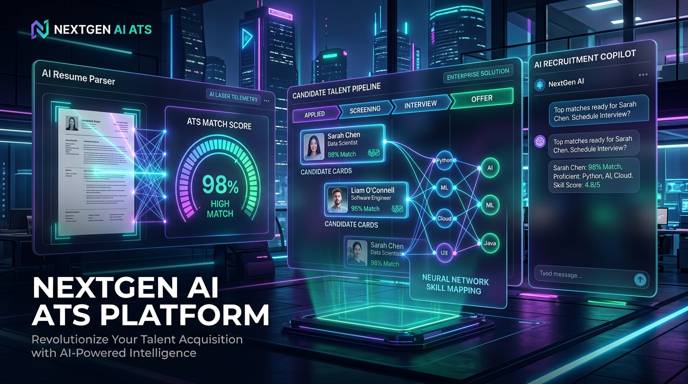
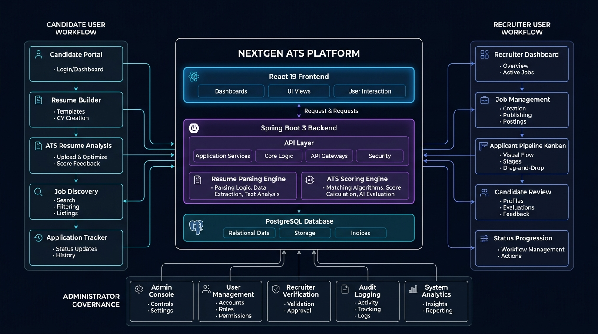

# NextGen ATS Platform



NextGen ATS Platform is a full-stack recruitment and applicant tracking application designed to connect candidate resume preparation, job applications, and recruiter workflows in one system.

The project aims to simplify the recruitment journey by bringing resume management, ATS-oriented resume analysis, job discovery, application tracking, recruiter tools, and administrative oversight into a unified platform.

The application is developed with a React and TypeScript frontend, a Java Spring Boot backend, and a PostgreSQL database.

---

## 🏛️ System Architecture



The platform is designed around three distinct operational layers and three authorized user personas:

- **Client Layer (React 19 + TypeScript)**: Responsive single-page application built with Vite and Tailwind CSS. Provides dedicated role-based portals for Candidates, Recruiters, and Administrators with client-side route protection and JWT session handling.
- **Service Layer (Spring Boot 3 + Java 21)**: RESTful backend enforcing Role-Based Access Control (RBAC) via Spring Security 6. Manages resume entity extraction (Apache PDFBox & Apache POI), multi-vector ATS scoring algorithms, job lifecycle states, audit logging, and optional Gemini-powered copilot assistance.
- **Persistence Layer (PostgreSQL)**: Relational storage managed via Spring Data JPA and Hibernate. Maintains schema constraints, relational integrity, recruiter verification statuses, candidate dossiers, and single-administrator singleton guarantees.

---

## 🌟 Verified Core Capabilities

### 👨‍💻 Candidate Experience
- **Resume Management**: Upload, preview, and organize resumes in PDF and DOCX formats with primary resume toggling.
- **Automated Entity Extraction**: Ingests resume files and extracts structured candidate data including technical skills, work experience, education history, and contact information.
- **ATS Resume Analysis**: Real-time evaluation against targeted job requisitions with multi-vector scoring (keyword match, technical skills, experience relevance, education alignment, and document formatting) along with missing keyword detection.
- **Job Discovery & Application**: Browse published job openings with department, location, and skill-compatibility filtering. Submit applications with one click.
- **Live Application Tracking**: Monitor status updates and milestone progressions across the complete application lifecycle.

### 🏢 Recruiter Command Center
- **Job Requisition Management**: Author, publish, edit, close, or archive job postings with required skill tags, experience levels, and compensation ranges.
- **Applicant Pipeline**: Dual Kanban board and structured table views to inspect applicant dossiers, rank candidates by calculated ATS match scores, and review extracted resumes.
- **Candidate Evaluation & Progression**: Advance applicants through a six-stage hiring workflow (`APPLIED` → `SCREENING` → `SHORTLISTED` → `INTERVIEW` → `OFFERED` / `REJECTED`) with recruiter evaluation notes.
- **Company Branding**: Configure company profile information, mission, and benefits.

### 🛡️ Administrative Governance
- **Single-Administrator Policy**: Enforces a strict single-admin architecture at both the application layer and database level (`idx_users_single_admin` partial unique index) to prevent unauthorized privilege escalation.
- **Recruiter Organization Verification**: Multi-state verification workflow (`UNVERIFIED`, `PENDING`, `VERIFIED`, `REJECTED`) ensuring only validated employers can publish active job requisitions.
- **User & Account Oversight**: Search, inspect, and toggle activation or suspension states for candidate and recruiter accounts.
- **Job Moderation**: Audit active listings across the platform to ensure policy compliance.
- **Audit Logging & Security Alerts**: System activity log tracking administrative operations, status modifications, and security-relevant platform events.

---

## 💻 Technology Stack

### Frontend
| Technology | Version | Purpose |
|---|---|---|
| **React** | `19.0.0` | Declarative user interface framework |
| **TypeScript** | `5.7.2` | Static typing and interface contracts |
| **Vite** | `6.1.0` | Development server and production bundler |
| **Tailwind CSS** | `3.4.17` | Utility-first responsive design system |
| **React Router** | `7.1.5` | Client-side routing and protected route guards |
| **Framer Motion** | `13.1.0` | Accessible UI transitions and micro-interactions |
| **Lucide React** | `0.475.0` | Consistent iconography |
| **Oxlint** | `1.81.0` | Fast static code analysis and linting |

### Backend
| Technology | Version | Purpose |
|---|---|---|
| **Java** | `21` | Modern LTS Java runtime |
| **Spring Boot** | `3.3.4` | Application foundation and REST API layer |
| **Spring Security** | `6.x` | Stateless JWT authentication and RBAC |
| **Spring Data JPA** | `3.3.4` | ORM and relational repository persistence |
| **Hibernate** | `6.x` | Relational database mapping and schema updates |
| **JJWT** | `0.12.6` | JSON Web Token generation and validation |
| **Apache PDFBox** | `3.0.3` | Text and metadata extraction from PDF resumes |
| **Apache POI** | `5.3.0` | Text and document parsing for DOCX resumes |
| **Spring Boot Mail** | `3.3.4` | SMTP client for transactional password resets |

### Database & Optional Integrations
- **PostgreSQL**: Primary relational database with ACID guarantees.
- **Google Gemini API** *(Optional)*: Integrated via `gemini-2.5-flash` for TalentPilot Copilot assistance. Gracefully degrades when unconfigured.
- **SMTP Service** *(Optional)*: Gmail/SMTP configuration for password reset verification emails.

---

## 🔄 User Workflows

```
[Candidate] ──> Upload Resume ──> 5-Vector ATS Analysis ──> Browse Jobs ──> Apply
                                                                               │
[Recruiter] ──> Verify Company ──> Post Requisition ──> Review Applicants <────┘
                                                               │
                                                       Move Pipeline Stage
                                                               │
                                                   (Shortlist / Interview)
                                                               │
[Admin]     ──> Verify Recruiters ──> Moderate Jobs ──> System Audit Logs
```

1. **Candidate Journey**: Candidates register, upload their existing resume, and review their automated ATS match score and extracted skills. They browse openings matched to their stack and submit applications directly to recruiter pipelines.
2. **Recruiter Journey**: Recruiters register under an employer profile. Once verified by an administrator, they create targeted requisitions. When candidates apply, recruiters view ATS-ranked applicant lists on an interactive Kanban board and progress them to interview stages.
3. **Administrator Governance**: Platform administrators review pending employer verifications, monitor user accounts, audit job postings, and review system activity logs.

---

## 🚀 Local Setup & Installation

### Prerequisites
- **Java Development Kit (JDK)**: Version 21
- **Apache Maven**: Version 3.9+ (or included Maven wrapper)
- **Node.js**: Version 18+ or 20+
- **PostgreSQL**: Version 14+
- **Git**

---

### Step 1: Database Setup
Start your local PostgreSQL service and create a dedicated database:
```sql
CREATE DATABASE ai_ats_db;
```

---

### Step 2: Environment Configuration
Copy the root `.env.example` file into `backend/.env`:
```bash
cp .env.example backend/.env
```

Review and adjust the configuration values in `backend/.env` as needed:
```env
# Database Credentials
SPRING_DATASOURCE_URL=jdbc:postgresql://localhost:5432/ai_ats_db
SPRING_DATASOURCE_USERNAME=postgres
SPRING_DATASOURCE_PASSWORD=your_postgres_password

# JWT Authentication
JWT_SECRET=your_secure_random_64_character_jwt_secret_do_not_share
JWT_EXPIRATION_MS=86400000

# Administrator Initial Provisioning (Optional on first launch)
ADMIN_EMAIL=admin@ai-ats.internal
ADMIN_INITIAL_PASSWORD=
ADMIN_BOOTSTRAP_TOKEN=dev-admin-bootstrap-secret-2026

# Frontend Client Origin
FRONTEND_URL=http://localhost:5173
CORS_ALLOWED_ORIGIN=http://localhost:5173

# Optional: Google Gemini API (Leave blank for offline fallback)
GEMINI_API_KEY=

# Optional: SMTP Mail (Leave blank if email service is not required locally)
MAIL_USERNAME=
MAIL_PASSWORD=
```

---

### Step 3: Run the Backend
Navigate to the `backend/` directory and start the Spring Boot application:
```bash
cd backend
mvn clean compile
mvn spring-boot:run
```
The backend server starts on `http://localhost:8080`.

---

### Step 4: Run the Frontend
In a separate terminal, navigate to `frontend/`, install dependencies, and launch the Vite development server:
```bash
cd frontend
npm install
npm run dev
```
The frontend application opens on `http://localhost:5173`.

---

## 🔑 Initial Access & Provisioning

### Sample Development Users
The database seeder provisions initial demo accounts for immediate local evaluation:
- **Candidate Portal**: `alex.rivera@example.com`
- **Recruiter Portal**: `talent@coursera.org`

### Administrator Provisioning
In accordance with the platform's **Single-Administrator Policy**, public administrator registration is disabled. An administrator account can be created using one of two methods:

1. **Environment Provisioning**: Define `ADMIN_EMAIL` and `ADMIN_INITIAL_PASSWORD` in your `backend/.env` file before initial startup. The server registers the account with BCrypt password hashing.
2. **Bootstrap API Endpoint**: If no administrator exists in the database, operators can initialize the account using the configured bootstrap secret token:
   ```bash
   curl -X POST http://localhost:8080/api/auth/admin/bootstrap \
     -H "Content-Type: application/json" \
     -d '{
       "fullName": "System Administrator",
       "email": "admin@your-domain.internal",
       "password": "YourSecurePassword123!",
       "bootstrapToken": "your-configured-bootstrap-token"
     }'
   ```
   *Once an administrator is registered, the bootstrap endpoint is permanently locked.*

---

## 🧪 Testing & Verification

### Backend Verification
Run the backend automated test suite using Maven:
```bash
cd backend
mvn test
```
Tests validate:
- Recruiter verification authorization rules and access gates.
- Single-admin singleton enforcement and bootstrap locking.
- Password reset token lifecycles and authentication service logic.
- Apache PDFBox and Apache POI resume parsing routines.

### Frontend Quality Checks
Run TypeScript static verification, the production build, and linting:
```bash
cd frontend

# Verify TypeScript types and compile production bundle
npm run build

# Run static linter
npm run lint
```

---

## 🔒 Security & Privacy Architecture

- **Stateless Authentication**: Uses cryptographically signed JWT tokens with standard expiration windows. Tokens are validated on every request via Spring Security filters.
- **Role-Based Access Control**: Strict separation between `ROLE_CANDIDATE`, `ROLE_RECRUITER`, and `ROLE_ADMIN` enforced on all REST endpoints with `@PreAuthorize`.
- **Password Protection**: Passwords are encrypted using BCrypt with a secure work factor prior to storage.
- **Upload Validation**: File uploads enforce strict MIME type checking (`application/pdf`, `application/vnd.openxmlformats-officedocument.wordprocessingml.document`) and file size limits (20MB) to mitigate malicious file ingestion.
- **Recruiter Verification Barrier**: Unverified employer profiles cannot broadcast public job requisitions until approved by an administrator, protecting candidate data from unverified entities.
- **Audit Logging**: Sensitive administrative actions and authentication anomalies are logged to the `system_activity_logs` table without recording raw credentials.

---

## 📄 License
This project is licensed under the [MIT License](LICENSE).
